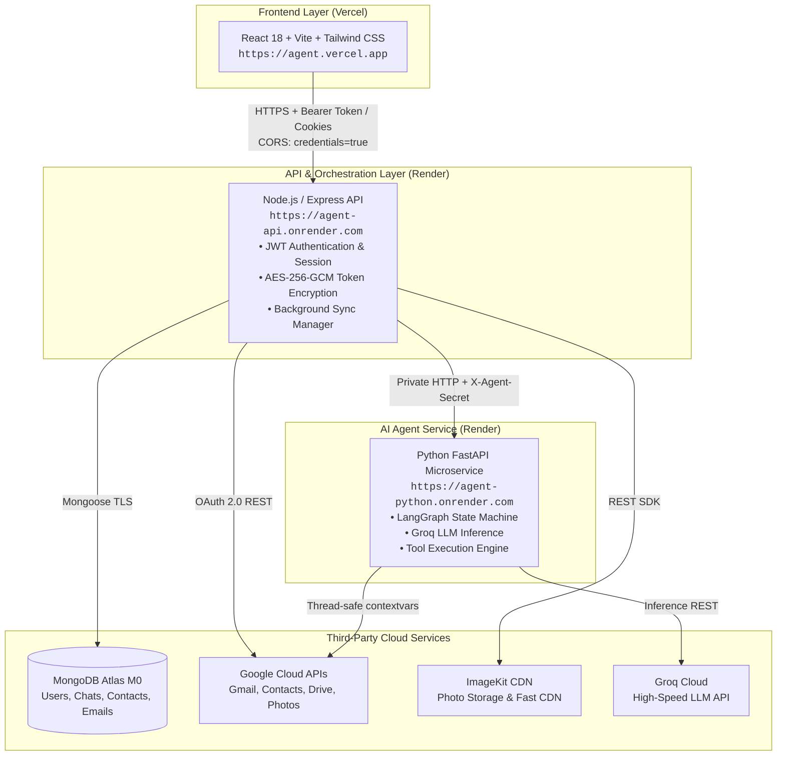

# Personal AI Agent — Production Deployment Guide

A comprehensive, step-by-step production deployment guide for deploying the complete Personal AI Agent stack across **Render** (Node.js API & Python LangGraph Agent), **Vercel** (React + Vite Frontend), **MongoDB Atlas** (Database), and **ImageKit** (Photos CDN).

---

## 1. System Architecture & Topology



---

## 2. Prerequisites & Accounts

Before deploying, create the following free-tier accounts:

| Service | Purpose | Free Tier Limit |
|---|---|---|
| **GitHub** | Code repository source for Vercel and Render | Unlimited public/private repos |
| **Render** | Hosts Node.js backend and Python LangGraph agent | Free web services (750 hrs/month) |
| **Vercel** | Hosts React Vite frontend with global CDN | Unlimited deployments, 100 GB bandwidth |
| **MongoDB Atlas** | Hosted MongoDB cloud database | M0 cluster (512 MB storage, shared RAM) |
| **Google Cloud** | OAuth 2.0 consent, Gmail, Contacts & Drive APIs | Free usage quotas |
| **ImageKit** | User photos storage and CDN image optimization | Free tier (20 GB bandwidth / 20 GB media) |
| **Groq Cloud** | High-speed LLM inference (`openai/gpt-oss-120b`) | Free developer tier |

---

## 3. Step 1: MongoDB Atlas Database Setup

1. Sign in to [MongoDB Atlas](https://www.mongodb.com/cloud/atlas).
2. Click **Create Cluster** and select **M0 (Free)**.
3. Under **Security > Database Access**:
   - Click **Add New Database User**.
   - Choose **Password Authentication**.
   - Username: `agent_admin`
   - Password: Click **Autogenerate Secure Password** and copy it.
   - Database User Privileges: `Read and write to any database`.
4. Under **Security > Network Access**:
   - Click **Add IP Address**.
   - Click **Allow Access From Anywhere** (`0.0.0.0/0`).
   - *Why:* Render uses dynamic outbound IP addresses for free web services.
5. Under **Deployments > Database**:
   - Click **Connect** next to your cluster.
   - Choose **Drivers** (Node.js).
   - Copy the connection string. It looks like:
     ```
     mongodb+srv://agent_admin:<password>@cluster0.xxxxx.mongodb.net/?retryWrites=true&w=majority&appName=Cluster0
     ```
   - Replace `<password>` with your database user password.

---

## 4. Step 2: Google Cloud Console Configuration

### 4.1. Enable Required APIs
1. Open [Google Cloud Console](https://console.cloud.google.com/).
2. Create a new project (e.g., `personal-ai-agent`).
3. Navigate to **APIs & Services > Library** and enable each of these 4 APIs:
   - **Gmail API**
   - **Google People API** (Contacts)
   - **Google Drive API**
   - **Google Photos Picker API**

### 4.2. Configure OAuth Consent Screen
1. Go to **APIs & Services > OAuth consent screen**.
2. Select **External** and click **Create**.
3. Fill in:
   - App Name: `Personal AI Agent`
   - User Support Email: your email
   - Developer Contact Email: your email
4. In **Scopes**, click **Add or Remove Scopes** and add:
   - `https://www.googleapis.com/auth/gmail.readonly`
   - `https://www.googleapis.com/auth/gmail.send`
   - `https://www.googleapis.com/auth/gmail.compose`
   - `https://www.googleapis.com/auth/contacts`
   - `https://www.googleapis.com/auth/drive.readonly`
   - `https://www.googleapis.com/auth/photospicker.mediaitems.readonly`
   - `https://www.googleapis.com/auth/userinfo.email`
   - `https://www.googleapis.com/auth/userinfo.profile`
5. In **Test Users**, click **Add Users** and enter your personal Google email address.

### 4.3. Create OAuth 2.0 Client Credentials
1. Go to **APIs & Services > Credentials > Create Credentials > OAuth client ID**.
2. Application type: **Web application**.
3. Name: `Personal AI Agent Web Client`.
4. **Authorized JavaScript origins**:
   ```
   http://localhost:5173
   https://<your-frontend-subdomain>.vercel.app
   ```
5. **Authorized redirect URIs**:
   ```
   http://localhost:3000/api/v1/integrations/google/callback
   https://<your-backend-service>.onrender.com/api/v1/integrations/google/callback
   ```
   *(You will update the Render URL after creating your Render backend service).*
6. Click **Create** and save your **Client ID** and **Client Secret**.

---

## 5. Step 3: ImageKit CDN Setup

1. Create a free account at [ImageKit.io](https://imagekit.io).
2. Go to **Developer Options**:
   - Copy **Public Key** (`IMAGEKIT_PUBLIC_KEY`)
   - Copy **Private Key** (`IMAGEKIT_PRIVATE_KEY`)
   - Copy **URL-endpoint** (`IMAGEKIT_URL_ENDPOINT`, e.g. `https://ik.imagekit.io/your_id/`)

---

## 6. Step 4: Deploy Python LangGraph Agent on Render

The Python microservice executes the LangGraph workflow and handles Groq LLM inference and tool calling.

### Render Configuration
1. Log in to [Render](https://dashboard.render.com).
2. Click **New + > Web Service**.
3. Select your GitHub repository.
4. Configure service settings:
   - **Name:** `personal-agent-python`
   - **Region:** Choose the region closest to you (e.g., Frankfurt, Ohio, Oregon, Singapore)
   - **Branch:** `main`
   - **Root Directory:** `personal-agent/agent`
   - **Runtime:** `Python 3`
   - **Build Command:** `pip install -r requirements.txt`
   - **Start Command:** `python server.py`
   - **Instance Type:** `Free`

### Environment Variables Checklist (Python Agent)
In the **Environment** tab, add:

| Key | Example Value | Description |
|---|---|---|
| `GROQ_API_KEY` | `gsk_...` | Groq API Key from console.groq.com |
| `GROQ_MODEL` | `openai/gpt-oss-120b` | High-speed LLM model identifier |
| `AGENT_SERVICE_SECRET` | `4f8a9e2c1b7d5e6f3a0b8c4d2e1f9a7b` | 32+ character shared secret between Node and Python |
| `AGENT_HOST` | `0.0.0.0` | Host binding interface |
| `PORT` | `8000` | Port (*Render auto-injects `PORT`; `server.py` reads it*) |

5. Click **Create Web Service**. Wait for the build and deployment to succeed.
6. Copy the assigned URL (e.g. `https://personal-agent-python.onrender.com`).
7. **Verification:** Open `https://personal-agent-python.onrender.com/health` in your browser. You should receive:
   ```json
   {"status":"ok","service":"personal-ai-agent","model":"openai/gpt-oss-120b"}
   ```

---

## 7. Step 5: Deploy Express/Node.js Backend on Render

The Node.js backend handles user accounts, JWT sessions, AES-256-GCM token encryption, MongoDB storage, background sync, ImageKit uploads, and acts as the secure gateway to the Python agent.

### Render Configuration
1. In Render dashboard, click **New + > Web Service**.
2. Select your GitHub repository.
3. Configure service settings:
   - **Name:** `personal-agent-backend`
   - **Region:** Same region as Python service
   - **Branch:** `main`
   - **Root Directory:** `backend`
   - **Runtime:** `Node`
   - **Build Command:** `npm install`
   - **Start Command:** `npm start`
   - **Instance Type:** `Free`

### Environment Variables Checklist (Node.js Backend)
In the **Environment** tab, add:

| Key | Example Value | Description |
|---|---|---|
| `NODE_ENV` | `production` | Enables production security & optimizations |
| `PORT` | `3000` | Port (*Render auto-injects `PORT`*) |
| `FRONTEND_URL` | `https://your-frontend.vercel.app` | Exact URL of your deployed Vercel frontend |
| `BACKEND_PUBLIC_URL` | `https://personal-agent-backend.onrender.com` | Public URL of this Render backend |
| `MONGODB_URI` | `mongodb+srv://agent_admin:<password>@cluster0.xxxxx.mongodb.net/?retryWrites=true&w=majority` | MongoDB Atlas connection string |
| `MONGODB_DB_NAME` | `personal_agent` | MongoDB database name |
| `SESSION_SECRET` | `a9b8c7d6e5f4a3b2c1d0e9f8a7b6c5d4` | Random 32+ character string for JWT signing |
| `COOKIE_NAME` | `agent_token` | Name of the session cookie |
| `SESSION_MAX_AGE_MS` | `604800000` | Cookie / token validity (7 days in ms) |
| `GOOGLE_TOKEN_ENCRYPTION_KEY` | `e2f1a0b9c8d7e6f5a4b3c2d1e0f9a8b7` | **Crucial:** Exactly 32 characters for AES-256-GCM encryption |
| `GOOGLE_CLIENT_ID` | `1234567890-xxx.apps.googleusercontent.com` | From Google Cloud Console |
| `GOOGLE_CLIENT_SECRET` | `GOCSPX-xxxxxxxxxxxx` | From Google Cloud Console |
| `GOOGLE_REDIRECT_URI` | `https://personal-agent-backend.onrender.com/api/v1/integrations/google/callback` | OAuth callback target |
| `AGENT_BASE_URL` | `https://personal-agent-python.onrender.com` | URL of the deployed Render Python agent |
| `AGENT_SERVICE_SECRET` | `4f8a9e2c1b7d5e6f3a0b8c4d2e1f9a7b` | Must match `AGENT_SERVICE_SECRET` in Python agent |
| `IMAGEKIT_PUBLIC_KEY` | `public_xxxxxxxxxxxx` | From ImageKit Developer Options |
| `IMAGEKIT_PRIVATE_KEY` | `private_xxxxxxxxxxxx` | From ImageKit Developer Options |
| `IMAGEKIT_URL_ENDPOINT` | `https://ik.imagekit.io/your_id/` | From ImageKit Developer Options |

> [!TIP]
> **Generating Secure Keys:**
> Run this locally in PowerShell or Bash to generate a cryptographic 32-character string:
> ```bash
> node -e "console.log(require('crypto').randomBytes(16).toString('hex'))"
> ```

4. Click **Create Web Service**.
5. Once deployed, copy your backend URL (e.g. `https://personal-agent-backend.onrender.com`).
6. **Update Google Cloud Console:**
   Return to Google Cloud Console > Credentials > your OAuth Client ID, and ensure `https://personal-agent-backend.onrender.com/api/v1/integrations/google/callback` is listed under **Authorized redirect URIs**.

---

## 8. Step 6: Deploy React Frontend on Vercel

The frontend is a modern, responsive Single Page Application built with React 18, Vite, and Tailwind CSS.

### Vercel Deployment Steps
1. Log in to [Vercel](https://vercel.com) and click **Add New... > Project**.
2. Connect your GitHub repository.
3. Configure the project:
   - **Framework Preset:** `Vite`
   - **Root Directory:** Click **Edit** and choose `frontend`
   - **Build Command:** `npm run build`
   - **Output Directory:** `dist`
   - **Install Command:** `npm install`
4. Expand **Environment Variables** and add:

| Key | Value | Description |
|---|---|---|
| `VITE_API_BASE_URL` | `https://personal-agent-backend.onrender.com/api/v1` | Points to your Render backend API |

5. Click **Deploy**. Vercel will build and assign a domain (e.g. `https://personal-ai-agent-seven.vercel.app`).

---

## 9. Connecting Frontend to Backend & CORS Configuration

To allow seamless communication between your Vercel frontend and Render backend:

### 1. Update `FRONTEND_URL` on Render
In your `personal-agent-backend` service on Render:
- Go to **Environment**.
- Update `FRONTEND_URL` to your production Vercel domain:
  ```
  FRONTEND_URL=https://personal-ai-agent-seven.vercel.app
  ```
- Click **Save Changes**. Render will automatically restart the backend.

### 2. How CORS Works in the Backend
The backend (`backend/src/app.js`) is configured with credentialed cross-origin support:
```javascript
const allowedOrigins = [
  config.frontendUrl,
  'http://localhost:5173',
  'http://localhost:3000',
];

app.use(
  cors({
    origin: (origin, callback) => {
      // Allows server-to-server, specific frontendUrl, or any *.vercel.app deployment
      if (!origin || allowedOrigins.includes(origin) || origin.endsWith('.vercel.app')) {
        callback(null, true);
      } else {
        callback(null, true);
      }
    },
    credentials: true,
    methods: ['GET', 'POST', 'PUT', 'DELETE', 'OPTIONS'],
    allowedHeaders: ['Content-Type', 'Authorization', 'X-Requested-With'],
  })
);
```

### 3. Dual-Layer Session Authentication (Cross-Site Cookie Safe)
- Some mobile browsers (Safari, iOS Chrome) block third-party cookies across different domains (`.vercel.app` vs `.onrender.com`).
- The frontend client (`frontend/src/api/client.js`) solves this by utilizing **dual authentication**:
  1. It includes `credentials: 'include'` for standard same-site/cross-site HTTP-only cookies.
  2. It also automatically attaches `Authorization: Bearer <token>` from `localStorage` on every request.
- The backend authentication middleware inspects both cookies and bearer tokens, guaranteeing seamless login across all devices and browsers.

---

## 10. Complete Environment Variables Summary

### Render Python Agent (`personal-agent/agent`)
```env
GROQ_API_KEY=gsk_your_groq_key_here
GROQ_MODEL=openai/gpt-oss-120b
AGENT_SERVICE_SECRET=generate_32_character_secret_here
AGENT_HOST=0.0.0.0
PORT=8000
```

### Render Node.js Backend (`backend`)
```env
NODE_ENV=production
PORT=3000
FRONTEND_URL=https://<your-project>.vercel.app
BACKEND_PUBLIC_URL=https://<your-backend>.onrender.com
MONGODB_URI=mongodb+srv://<user>:<password>@cluster0.xxxxx.mongodb.net/?retryWrites=true&w=majority
MONGODB_DB_NAME=personal_agent
SESSION_SECRET=generate_32_character_secret_here
COOKIE_NAME=agent_token
SESSION_MAX_AGE_MS=604800000
GOOGLE_TOKEN_ENCRYPTION_KEY=generate_exact_32_chars_key_here
GOOGLE_CLIENT_ID=xxxxxxxxxxxx.apps.googleusercontent.com
GOOGLE_CLIENT_SECRET=GOCSPX-xxxxxxxxxxxx
GOOGLE_REDIRECT_URI=https://<your-backend>.onrender.com/api/v1/integrations/google/callback
AGENT_BASE_URL=https://<your-python-agent>.onrender.com
AGENT_SERVICE_SECRET=generate_32_character_secret_here
IMAGEKIT_PUBLIC_KEY=public_xxxxxxxxxxxx
IMAGEKIT_PRIVATE_KEY=private_xxxxxxxxxxxx
IMAGEKIT_URL_ENDPOINT=https://ik.imagekit.io/your_id/
```

### Vercel React Frontend (`frontend`)
```env
VITE_API_BASE_URL=https://<your-backend>.onrender.com/api/v1
```

---

## 11. Verification & End-to-End Testing

Once all three services are live, verify end-to-end functionality:

1. **User Registration & Login:**
   - Open your Vercel URL `https://your-frontend.vercel.app`.
   - Register a new account (`name`, `email`, `password`).
   - Verify you are redirected into the main chat dashboard.

2. **Google OAuth Link:**
   - Click **Connect Google** in the top navigation bar.
   - Complete Google's authentication consent screen.
   - Verify the modal shows **Connected** with your Gmail address.

3. **Background Sync:**
   - In the Google Integration modal, verify the sync counters for **Contacts**, **Emails**, and **Drive Files** populate into MongoDB.

4. **Photos & ImageKit CDN:**
   - Open **Photos & CDN Gallery** modal.
   - Click **Sync All Photos** or upload an image directly.
   - Verify the photo appears with an `ImageKit` badge.
   - Click on the photo to test the High-Resolution Lightbox (zoom in, zoom out, copy CDN link).

5. **Agent Natural Language Commands:**
   - In the chat interface, send:
     - `"Summarize my recent unread emails"` $\rightarrow$ Agent summarizes your Gmail inbox.
     - `"Find contact John"` $\rightarrow$ Agent queries synced contacts.
     - `"Send an email to user@example.com about project update"` $\rightarrow$ Agent drafts/sends real email via Gmail API.

---

## 12. Troubleshooting Common Issues

### Issue 1: Google OAuth `redirect_uri_mismatch` (Error 400)
- **Cause:** The callback URI called by Google does not match the exact list in Google Cloud Console.
- **Solution:** In Google Cloud Console > Credentials > OAuth Client ID > Authorized redirect URIs, make sure you have:
  ```
  https://<your-backend>.onrender.com/api/v1/integrations/google/callback
  ```
  Check that there are no trailing slashes or typos.

### Issue 2: Render Free Tier Cold Starts
- **Cause:** Render free web services spin down after 15 minutes of inactivity. The first request after sleep may take 45–60 seconds.
- **Solution:** Use an external free health monitoring ping service (e.g. [UptimeRobot](https://uptimerobot.com) or [Cron-Job.org](https://cron-job.org)) to ping `https://<your-backend>.onrender.com/` and `https://<your-python-agent>.onrender.com/health` every 10 minutes to keep them warm 24/7.

### Issue 3: Python Agent 401 Unauthorized
- **Cause:** The `AGENT_SERVICE_SECRET` in the Node.js backend does not match the `AGENT_SERVICE_SECRET` in the Python agent service.
- **Solution:** Copy the exact secret value from Render backend environment settings into Render Python agent environment settings and trigger a manual redeploy.

### Issue 4: MongoDB Atlas Connection Timeout
- **Cause:** MongoDB Atlas Network Access is restricting incoming IPs.
- **Solution:** In MongoDB Atlas > Network Access, ensure IP `0.0.0.0/0` (Allow access from anywhere) is active.

### Issue 5: CORS Blocked on Vercel Preview URLs
- **Cause:** Vercel generates unique preview deployment URLs (e.g. `https://agent-git-feat-xyz.vercel.app`).
- **Solution:** The backend CORS middleware already permits all origins ending with `.vercel.app`. If you use a custom domain (e.g. `https://agent.mycompany.com`), add it to `allowedOrigins` in `backend/src/app.js` and set `FRONTEND_URL` on Render.
