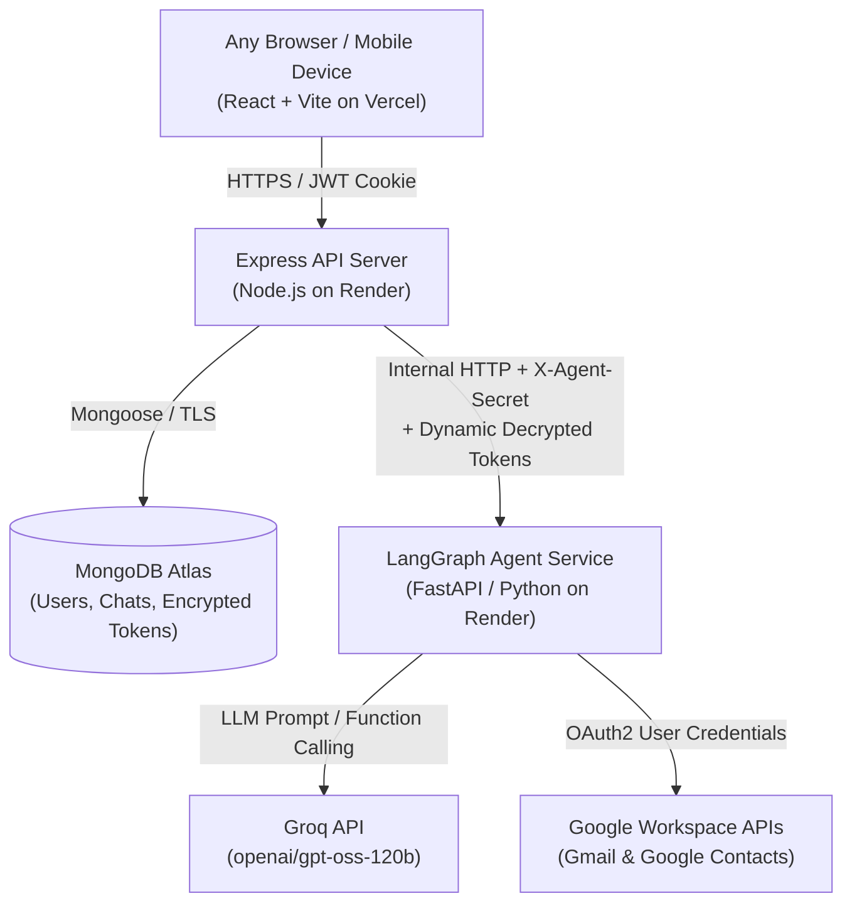
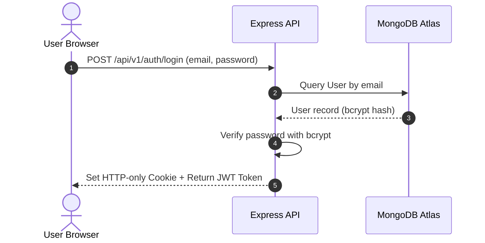
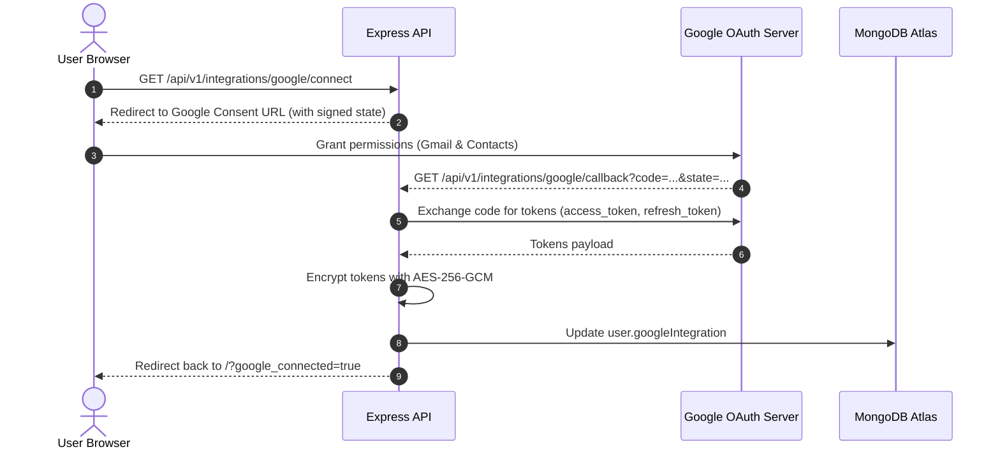
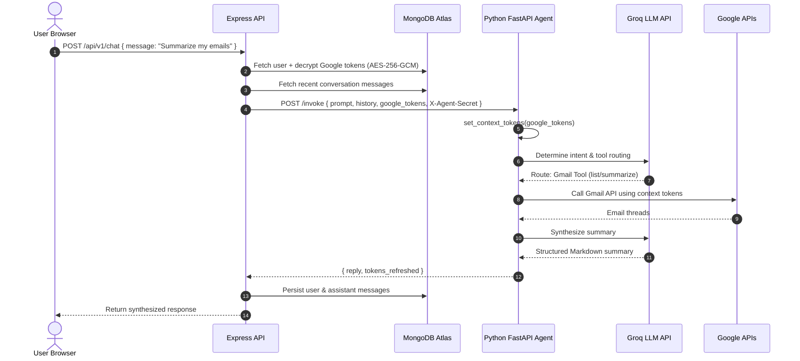

# Personal AI Agent - System Architecture

## 1. Overview

The Personal AI Agent is a decoupled, cloud-ready multi-tier system engineered to run 24/7 without requiring a personal computer to stay powered on. It provides:

1. **Independent Application Authentication:** Users log in using their own credentials (email and password), separated entirely from Google authentication.
2. **Persistent Google OAuth Integration:** Google tokens are authorized once via OAuth 2.0 offline access, encrypted at rest using AES-256-GCM in MongoDB Atlas, and reused across devices.
3. **Decoupled Python Agent Execution:** The Python LangGraph runtime is exposed as an internal microservice, receiving decrypted Google credentials on a per-request basis via Python `contextvars`.

---

## 2. High-Level Architecture Diagram

---

## 3. Core Subsystems

### 3.1. Frontend (`frontend/`)
- **Technology:** React 18, Vite, Lucide React.
- **Hosting:** Vercel (static single-page application).
- **Communication:** Sends credentials-included requests to Express API. Supports both HTTP-only secure cookies and `Authorization: Bearer <token>` fallback to ensure functionality across cross-origin mobile and desktop browsers.

### 3.2. Express API Backend (`backend/`)
- **Technology:** Node.js (ES Modules), Express, Mongoose, Google Auth Library, Helmet, CORS, Rate-Limiter.
- **Hosting:** Render Web Service.
- **Responsibilities:**
  - Manages user accounts and bcrypt password hashing.
  - Generates CSRF-protected Google OAuth consent URLs and exchanges authorization codes for long-lived offline refresh tokens.
  - Authenticates and encrypts tokens with AES-256-GCM prior to database persistence.
  - Manages chat conversations and message threads.
  - Serves as the secure orchestrator between client requests and the internal Python agent service.

### 3.3. Python LangGraph Agent (`personal-agent/agent/` & `agent/`)
- **Technology:** Python 3.14+, LangGraph, Groq SDK, Google API Client, FastAPI, Uvicorn.
- **Hosting:** Render Web Service (internal or public with `X-Agent-Secret` header guard).
- **Responsibilities:**
  - Implements the agent graph: user prompt $\rightarrow$ router intent analysis $\rightarrow$ tool execution $\rightarrow$ response synthesis.
  - Implements dynamic credential injection: Reads `google_tokens` from request payload, sets thread-safe `contextvars`, and executes Gmail and Contacts tools with valid OAuth tokens.
  - Completely eliminates Windows Credential Manager (`keyring`) dependencies for cloud execution while maintaining local fallback for CLI testing.

---

## 4. End-to-End Sequence Flows

### 4.1. Independent User Authentication

### 4.2. One-Time Google Account Connection

### 4.3. Chat Interaction with Tool Execution

