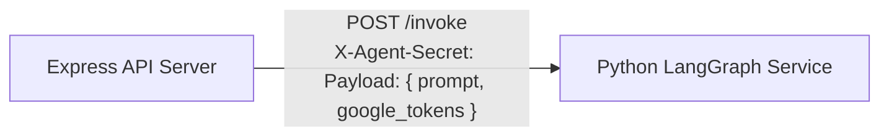

# Personal AI Agent - Security Specification

## 1. Threat Model & Security Posture

The Personal AI Agent is designed for secure, multi-device cloud deployment. Because personal emails, contacts, and AI responses pass through this infrastructure, security controls are applied across every layer: data at rest, data in transit, application authorization, and inter-service boundaries.

---

## 2. Token Security & At-Rest Encryption

Google OAuth tokens (specifically offline `refresh_token` and temporary `access_token`) are **never stored as plaintext** in the database.

### 2.1. AES-256-GCM Authenticated Encryption
- **Algorithm:** AES-256 in Galois/Counter Mode (GCM).
- **Key Derivation:** The 256-bit encryption key is derived using SHA-256 hashing over `GOOGLE_TOKEN_ENCRYPTION_KEY`.
- **Initialization Vector (IV):** A cryptographically secure random 12-byte (96-bit) IV is generated using `crypto.randomBytes(12)` for **every single encryption call**. An IV is never reused.
- **Authentication Tag:** A 16-byte (128-bit) GCM authentication tag is computed. Any modification, bit-flipping, or database tampering causes decryption to fail immediately with an authentication error.
- **Database Schema:**
  ```json
  {
    "googleIntegration": {
      "connected": true,
      "email": "user@gmail.com",
      "tokens": {
        "encryptedData": "a1b2c3d4...",
        "iv": "e5f6...",
        "authTag": "98a7..."
      }
    }
  }
  ```

---

## 3. Application Authentication & Session Management

### 3.1. Decoupled Identity
Application login is completely decoupled from Google accounts:
- Users log in using their email and password.
- Passwords are salt-hashed using **bcrypt** (10–12 salt rounds). Plaintext passwords never hit logs or persistent storage.
- Timing-safe error responses: Authentication endpoints return generic messages (`"Invalid email or password."`) to prevent user enumeration attacks.

### 3.2. Cookie & JWT Strategy
- **Session Tokens:** Signed JWT tokens using HMAC-SHA256 (`SESSION_SECRET`).
- **Cookie Security Attributes:**
  - `HttpOnly: true` (Prevents client-side JavaScript / XSS access).
  - `Secure: true` (Sent exclusively over HTTPS).
  - `SameSite: none` (Enables cross-origin credentialed requests between Vercel and Render).
- **Bearer Token Fallback:** To support mobile browsers that block third-party cookies by default, the client can also submit tokens via `Authorization: Bearer <token>`.

---

## 4. Inter-Service Boundary Security

The system separates the Express API and the Python LangGraph runtime:



### 4.1. Pre-Shared Service Secret
- Every invocation of `POST /invoke` requires an `X-Agent-Secret` header matching `AGENT_SERVICE_SECRET`.
- Unauthenticated requests receive an immediate `401 Unauthorized`.

### 4.2. Thread-Safe Dynamic Credential Isolation
- The Python agent utilizes Python's built-in `contextvars` (`ContextVar('_context_google_tokens')`).
- Credential lifecycles are bounded strictly to the execution context of each request:
  ```python
  token_ref = set_context_tokens(payload.google_tokens)
  try:
      response = agent_graph.invoke(...)
  finally:
      reset_context_tokens(token_ref)
  ```
- No user tokens are written to disk, persistent state, or shared global memory, eliminating cross-session credential pollution in multi-user or high-concurrency environments.

---

## 5. Google Workspace Scope Minimization

Permissions requested from Google OAuth are strictly scoped to the least-privilege set required for the implemented features:

| Scope | Purpose | Read/Write |
|---|---|---|
| `.../auth/gmail.readonly` | Read inbox emails, search messages, AI email summarization | Read-Only |
| `.../auth/contacts` | Search existing contacts, list contacts, create new contact entries | Read & Write |
| `.../auth/userinfo.email` | Verify Google identity of the authorized account | Read-Only |

> [!IMPORTANT]
> The agent **does not** request permissions to delete emails, send emails on your behalf, or modify your Google Drive or Calendar.

---

## 6. HTTP Hardening & Rate Limiting

- **Helmet:** Sets `Content-Security-Policy`, `X-Content-Type-Options: nosniff`, `X-Frame-Options: DENY`, and strict HSTS headers.
- **CORS:** Restricts `Access-Control-Allow-Origin` strictly to the configured `FRONTEND_URL` (or localhost during development).
- **Rate Limiting:**
  - Standard API endpoints: Max 100 requests per 15 minutes per IP.
  - Auth endpoints (`/login`, `/register`): Max 10 requests per 15 minutes per IP to mitigate brute-force attempts.
